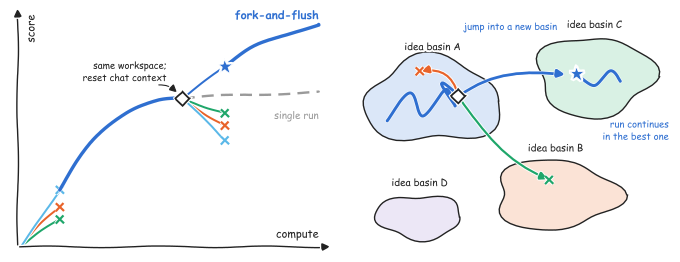

<h1 align="center">forknflush</h1>

<p align="center">
  <strong>Fork-and-Flush — escape plateaus on long-horizon optimization tasks.</strong>
  <br />
  <em>Works with Claude Code, Codex, Pi, Hermes Agent, and OpenCode.</em>
</p>

<p align="center">
  <a href="LICENSE"></a>
  <a href="#quick-start"></a>
  <a href="#claude-code-plugin"></a>
  <a href="#platform-notes"></a>
  <a href="#platform-notes"></a>
  <a href="#platform-notes"></a>
  <a href="#platform-notes"></a>
</p>

---



**Single long agent runs get stuck refining one early approach.** Fork-and-Flush fixes that: periodically fork K workers from the best workspace, each with an EMPTY chat context, run each briefly, keep the best. Both halves are needed — fork alone or flush alone gives less than both together.

The skill targets long-horizon optimization with a deterministic scalar grader: algorithmic score maximization, cycle-count tuning, model compression. **Not** for bug fixes, features, or tasks without a numeric metric.

This repo implements the *fork-and-flush* periodic intervention from the paper [Fork-and-Flush: Escaping Idea Basins in Autoresearch Agents](https://arxiv.org/abs/2610.07447) (Cai et al., 2026), which showed that independent agent runs plateau at substantially different scores — trajectories stay trapped in localized regions of the solution space, *idea basins* — and that forking into parallel trajectories with fresh chat contexts escapes them (a relative improvement of 66.0% over single runs and 44.4% over best-of-N across 13 long-horizon tasks).

One skill, one `SKILL.md`, packaged as a [Claude Code plugin](https://code.claude.com/docs/en/plugins-reference) and installable into every other major agent CLI.

---

## Quick Start

### Claude Code (plugin)

```bash
/plugin marketplace add etomoscow/forknflush
/plugin install forknflush
```

Then, on any optimization task:

```bash
/fork-and-flush
```

> The repo itself is the plugin marketplace (`.claude-plugin/marketplace.json`) — nothing needs to be uploaded or registered anywhere else; the commands above read it straight from GitHub.

### Codex, Pi, OpenCode, Hermes Agent (installer)

```bash
curl -fsSL https://raw.githubusercontent.com/etomoscow/forknflush/main/install.sh | bash -s <platform>
```

Supported platforms: `claude`, `pi`, `codex`, `opencode`, `hermes`. The installer clones this repo to `~/.forknflush/repo` and symlinks the skill into the platform's skills directory, so `./install.sh --update` (or re-running the command) keeps every install current.

```bash
# Codex (skills land in ~/.agents/skills; invoke with $fork-and-flush)
curl -fsSL https://raw.githubusercontent.com/etomoscow/forknflush/main/install.sh | bash -s codex

# Hermes Agent (skills land in ~/.hermes/skills/forknflush)
curl -fsSL https://raw.githubusercontent.com/etomoscow/forknflush/main/install.sh | bash -s hermes
```

On Windows (PowerShell):

```powershell
iex (irm https://raw.githubusercontent.com/etomoscow/forknflush/main/install.ps1)
```

Restart your CLI after installing.

## Platform notes

| Platform | Skills target | Invoke |
|---|---|---|
| Claude Code | `~/.claude/skills/` | `/fork-and-flush` |
| Pi | `~/.agents/skills/` | `/skill:fork-and-flush` |
| Codex | `~/.agents/skills/` | `$fork-and-flush` |
| OpenCode | `~/.agents/skills/` | automatic via the `skill` tool |
| Hermes Agent | `~/.hermes/skills/forknflush/` | `/fork-and-flush` |

Manual install (without the installer) — copy `forknflush-plugin/skills/fork-and-flush/` into the target directory above, or symlink it.

## What the skill does

Given a task with `$EVAL` (one command printing one deterministic scalar, higher is better) and a budget B:

1. **Preconditions** — wrap `$EVAL` in `.ff/eval.sh` with a usage log, tag the base commit `ff/base`, park the grader in `.ff/grader/`, ensure workers share no mutable state.
2. **Fork** — K=4 workers per round (capped at 0.06·B each), each in its own `git worktree` branched from the best verified commit, each with an EMPTY chat context and only the best score as a number.
3. **Select** — verify claimed scores yourself: check out the claimed commit clean, restore the grader, run `$EVAL`. Only your own reproduced number counts.
4. **Leader** — the winner's worktree becomes the leader's; it runs until the next trigger (33% and 66% of B), then fork again.
5. **Stop** — at B or on target; report the best verified commit across all branches ever created vs baseline.

Full protocol: [`forknflush-plugin/skills/fork-and-flush/SKILL.md`](forknflush-plugin/skills/fork-and-flush/SKILL.md)

## Layout

```
.claude-plugin/marketplace.json    # repo as a Claude Code plugin marketplace
.claude-plugin/plugin.json
forknflush-plugin/                 # the plugin
├── .claude-plugin/plugin.json
├── package.json
└── skills/fork-and-flush/SKILL.md # the skill (Agent Skills / agentskills.io format)
assets/                            # teaser figure (SVG for README, PDF original)
install.sh                         # macOS / Linux installer
install.ps1                        # Windows installer
```

## Installer management

```bash
./install.sh                        # prompt for platform
./install.sh codex                  # install for one platform
./install.sh --update               # git pull (skills update through symlinks)
./install.sh --uninstall codex      # remove links
```

Environment overrides: `FF_REPO_URL` (clone URL), `FF_DIR` (checkout destination).

## Citation

If you use fork-and-flush, please cite the paper it is based on:

> Ziyang Cai, Christos Ziakas, Vasilis Kontonis, Tim Pearce, Siddhartha Sen, Akshay Krishnamurthy, Shivam Garg, and Dimitris Papailiopoulos. **Fork-and-Flush: Escaping Idea Basins in Autoresearch Agents.** arXiv:2610.07447 [cs.LG], 2026. [https://arxiv.org/abs/2610.07447](https://arxiv.org/abs/2610.07447) (doi:[10.48550/arXiv.2610.07447](https://doi.org/10.48550/arXiv.2610.07447))

```bibtex
@misc{cai2026forkandflush,
  title         = {Fork-and-Flush: Escaping Idea Basins in Autoresearch Agents},
  author        = {Cai, Ziyang and Ziakas, Christos and Kontonis, Vasilis and Pearce, Tim and Sen, Siddhartha and Krishnamurthy, Akshay and Garg, Shivam and Papailiopoulos, Dimitris},
  year          = {2026},
  eprint        = {2610.07447},
  archivePrefix = {arXiv},
  primaryClass  = {cs.LG},
  doi           = {10.48550/arXiv.2610.07447},
  url           = {https://arxiv.org/abs/2610.07447}
}
```

## License

[MIT](LICENSE)
